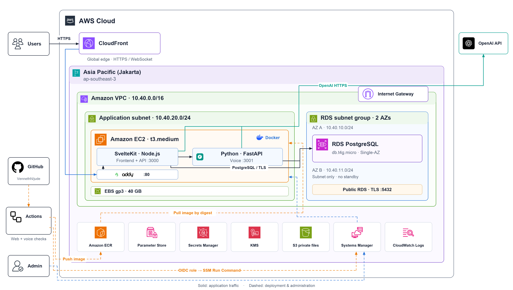

# Jude

**From testimony to evidence. From evidence to the next question.**

A courtroom workspace for reading case files, following testimony, and reviewing findings alongside their original sources. Built for Indonesian legal workflows, with Indonesian and English interfaces that preserve source material in its original language.

[](https://github.com/VennethN/jude/actions/workflows/deploy.yml)

[Web](apps/web/README.md) · [Voice](apps/voice/README.md) · [Deployment](apps/web/docs/aws.md) · [Product](apps/web/PRODUCT.md) · [Design](apps/web/DESIGN.md)

## One case. Connected sources.

| Workflow | What you can do |
| --- | --- |
| **Read the record** | Open original documents, inspect marked passages, and search the case file. |
| **Follow a hearing** | Capture audio, read transcripts, review speaker labels, and replay testimony. |
| **Review findings** | Compare statements with their cited evidence, assign review statuses, and keep examination notes. |
| **Prepare the case** | Organize evidence boards, explore relationships, bookmark passages, and ask source-linked questions. |

The example workspace provides a clearly labelled synthetic case. Real audio transcription requires OpenAI credentials and a configured diarization model. Users can review and correct the resulting transcripts and speaker labels.

## Architecture

[](infra/docs/architecture/aws-architecture.svg)

**Primary region: Asia Pacific (Jakarta), `ap-southeast-3`.** CloudFront provides the global HTTPS entry point. A single EC2 instance runs Caddy and a combined application image containing SvelteKit and Python voice. SvelteKit forwards voice traffic to FastAPI over an internal connection.

| Component | Responsibility |
| --- | --- |
| **SvelteKit · Node.js** | Frontend, authentication, case APIs, and analysis workers. |
| **FastAPI · Python** | Hearing audio, OpenAI transcription, and pyannote speaker diarization. |
| **EC2 `t3.medium`** | Shared web and voice host with a 40 GB gp3 volume. |
| **RDS PostgreSQL** | Shared application data; `db.t4g.micro`, Single-AZ, with a subnet group spanning two AZs. |
| **S3 + KMS** | Encrypted private storage for documents and audio. |
| **SSM Parameter Store** | Runtime credentials and configuration. Systems Manager handles deployment and host administration. |
| **Secrets Manager** | AWS-managed RDS master credentials. |
| **ECR · CloudWatch** | Application image registry and PostgreSQL log exports. |
| **OpenAI API** | Server-side transcription and analysis. |

The current hackathon configuration enables public RDS access on port `5432` with TLS and an allowlist of `0.0.0.0/0`. The EC2 HTTP origin accepts traffic only from CloudFront. Infrastructure settings live in [Terraform](infra/terraform/terraform.tfvars), with `Hackathon=true` on supported resources.

## Run locally

Install **Node.js 24**, **pnpm 10.33.2**, **Python 3.11 or 3.12**, and **FFmpeg**. From the repository root:

```sh
pnpm install --frozen-lockfile
python3.12 -m venv apps/voice/.venv
apps/voice/.venv/bin/python -m pip install -r apps/voice/requirements.txt
pnpm dev
```

Open **http://localhost:5173** and choose the example case. The launcher starts web and voice together. Without `DATABASE_URL`, local development uses SQLite and stores private files under `.jude-data/`.

Put web development settings in the Git-ignored `apps/web/.env`. Run `pnpm dev` from the repository root or `apps/web`; both use this file. Root development also reads `.env` as a fallback, while `pnpm start` uses the root `.env` for the combined production service. Environment templates are available for [web](apps/web/.env.example) and [voice](apps/voice/.env.example). See the [voice guide](apps/voice/README.md#enable-private-audio) for OpenAI credentials, speaker models, and audio storage.

Document extraction and conversion also use Poppler, LibreOffice, and Tesseract. These system dependencies are included in the production image.

## Repository layout

```text
apps/
  web/                  SvelteKit UI, server routes, and browser tests
  voice/                Python FastAPI, diarization, and voice tests
packages/core/          Shared domain, server logic, quotas, and backend tests
migrations/             SQL migrations used by web and voice
infra/
  terraform/            AWS resources and GitHub OIDC role
  docker/               Multi-stage Dockerfile for both applications
  deploy/               EC2 runtime and proxy scripts
  scripts/              SSM deployment and architecture generator
  docs/architecture/    PNG/SVG diagrams and source icons
scripts/                Workspace launchers
.github/workflows/      Checks and deployment
AGENTS.md               Repository working instructions
```

The root `package.json`, `pnpm-workspace.yaml`, and `pnpm-lock.yaml` manage workspace commands and shared dependency resolution. Web-specific source and tooling live in `apps/web`.

## Verify changes

```sh
pnpm check
pnpm test
pnpm test:voice
pnpm build
pnpm exec playwright install chromium
pnpm test:e2e
```

Database and browser suites run separately from the deployment pipeline. Run `pnpm design:check` for design-pattern checks and `node apps/web/scripts/check-bundle.mjs` for the initial JavaScript budget.

## Deploy to AWS

The [Lint and deploy workflow](.github/workflows/deploy.yml) runs **web static checks** and **Python lint**, without unit, database or E2E suites. Once both pass, an eligible push to `main` builds the Linux AMD64 `release-pyannote` image, publishes it to ECR, and deploys it through SSM. EC2 pulls the image by digest and checks both application processes before confirming proxy readiness.

GitHub authenticates to AWS through **OIDC**. Deployment settings are read from repository Actions Secrets:

```text
AWS_DEPLOY_ROLE_ARN    AWS_REGION          ECR_REPOSITORY
DEPLOY_OPS_BUCKET     DEPLOY_INSTANCE_ID   APP_URL
```

OpenAI credentials and the application database connection stay in SSM Parameter Store. Deployment replaces containers on the single host, causing a brief interruption; rollback is not automatic. See the [AWS guide](apps/web/docs/aws.md#github-actions) for setup and operational details.

## Regenerate the diagram

The architecture is generated from code using AWS and vendor icons stored in the repository. Rendering runs offline and produces PNG and SVG from the same layout:

```sh
python3 -m pip install -r infra/scripts/requirements-architecture.txt
python3 infra/scripts/generate-architecture.py
```

Add `--svg-only` to generate SVG without Pillow. Icon sources and checksums are recorded in [icons/sources.json](infra/docs/architecture/icons/sources.json).
