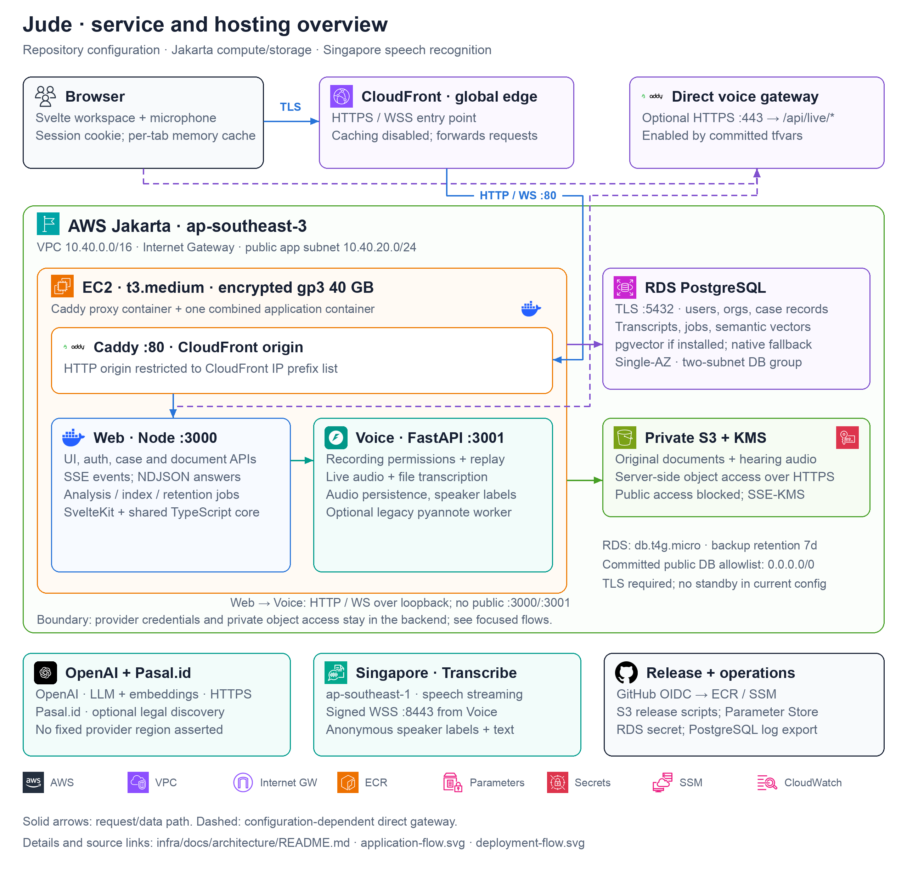
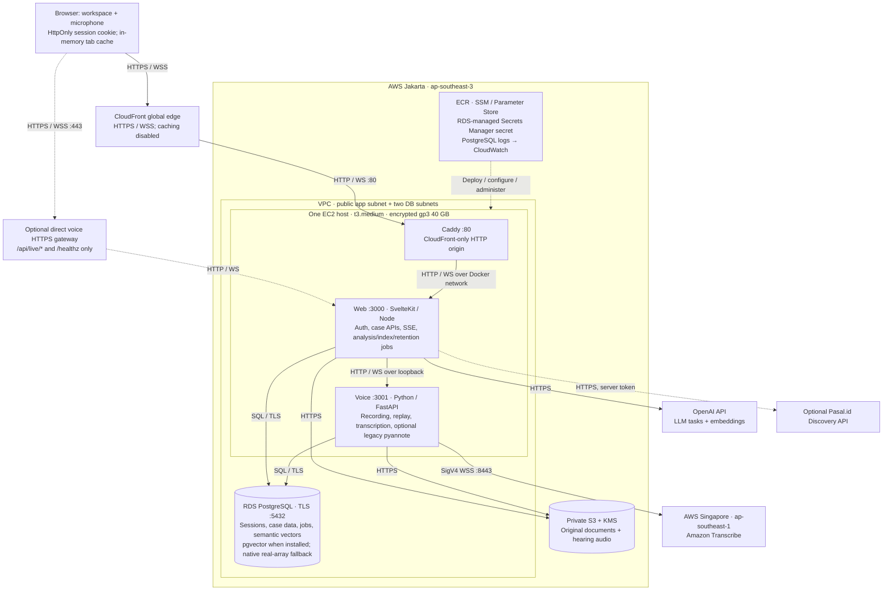
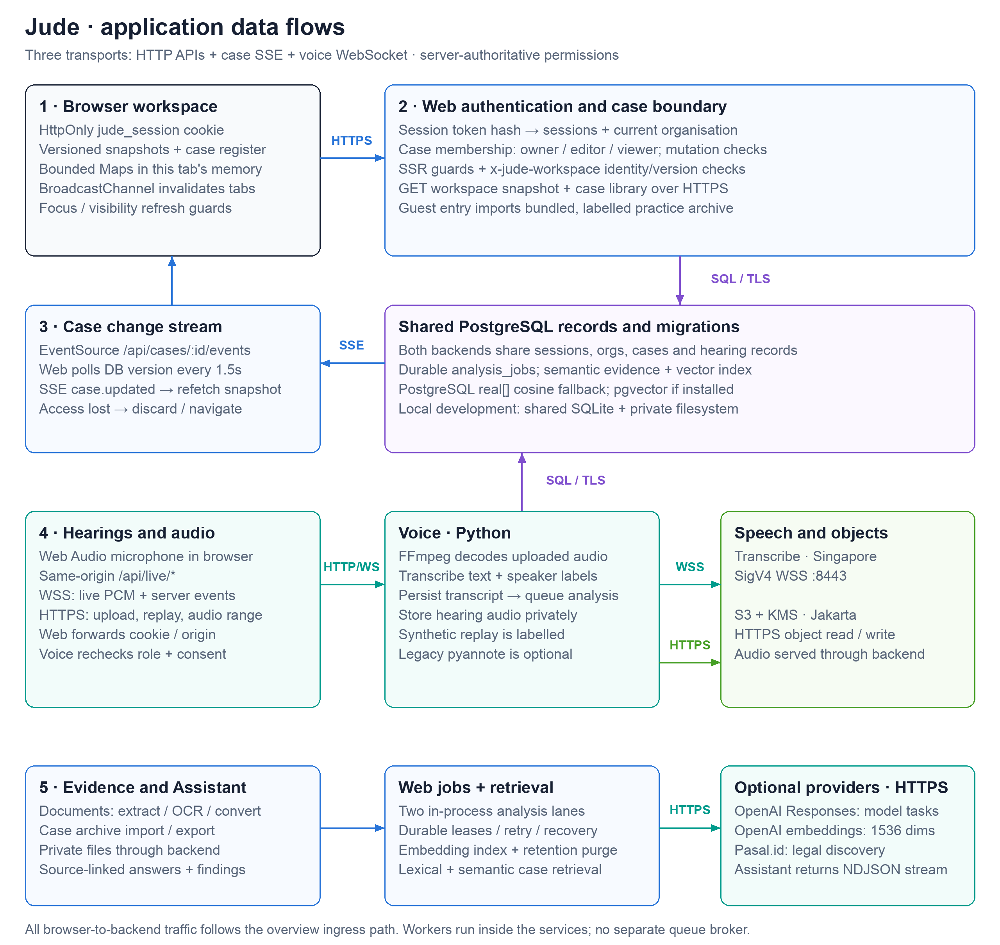
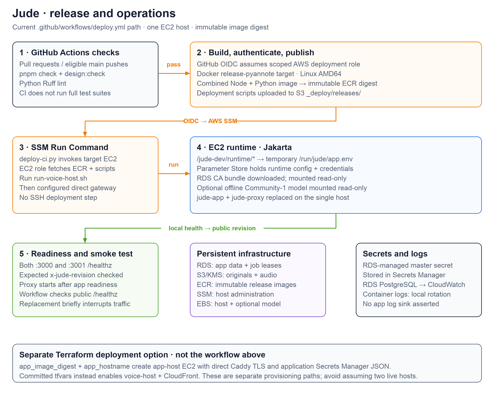

# Jude architecture

These diagrams describe the checked-in code and Terraform configuration, not a live AWS inventory. The canonical editable source is [generate-architecture.py](../../scripts/generate-architecture.py); the Mermaid overview below is portable to Markdown viewers. Each rendered view is 1,280 CSS pixels wide, uses 18 px body text, and has an SVG for zooming or sharing and a 2× PNG preview. Open a view separately for its full size.

| View | Rendered diagram | Purpose |
| --- | --- | --- |
| Service and hosting overview | [SVG](aws-architecture.svg) · [PNG](aws-architecture.png) | Browser, AWS boundaries, services, data stores and providers |
| Application data flows | [SVG](application-flow.svg) · [PNG](application-flow.png) | Authentication, tab cache, case SSE, voice WebSocket, analysis and retrieval |
| Release and operations | [SVG](deployment-flow.svg) · [PNG](deployment-flow.png) | GitHub Actions, OIDC, ECR, SSM, runtime configuration and health checks |



## Portable service map



## Application flows and trust boundaries



- **Browser and identity.** The browser receives a `jude_session` HttpOnly, SameSite=Lax cookie, marked Secure on HTTPS. Web hashes the opaque token and resolves its current session and organisation from the shared database. Case access checks membership and owner/editor/viewer roles. The Python service independently resolves the same cookie and checks case role, plan limits and recording permission. Credentials for external providers remain server-side. Sources: [auth.ts](../../../packages/core/src/server/auth.ts), [access.ts](../../../packages/core/src/server/access.ts), [voice repository](../../../apps/voice/jude_voice/repository.py), [voice HTTP and socket handlers](../../../apps/voice/jude_voice/app.py).
- **Workspace cache.** Versioned snapshots and the case register live in bounded JavaScript Maps within a browser tab; this is not a persistent case-data cache in `sessionStorage`. Server guards pass identity scope and versions; snapshot requests send `x-jude-workspace`. `BroadcastChannel` sends invalidation signals to other tabs. Focus/visibility and back-forward restoration trigger validation or reload. Sources: [tab-cache.ts](../../../apps/web/src/lib/workspace/tab-cache.ts), [workspace guards](../../../packages/core/src/server/workspace-paths.ts), [workspace layout](../../../apps/web/src/routes/%28workspace%29/+layout.svelte).
- **Three separate streams.** Case updates use `EventSource` to `/api/cases/:id/events`: the server rechecks session/membership and polls the database version every 1.5 seconds, then sends SSE notifications for the client to refetch. Assistant output uses an HTTP NDJSON response. Hearing capture uses a WebSocket at `/api/live/:case/:hearing/socket`; web forwards upgrades to Python. Sources: [case-api.ts](../../../packages/core/src/server/case-api.ts), [answer-stream.ts](../../../packages/core/src/server/answer-stream.ts), [Node gateway](../../../apps/web/server.mjs), [microphone.ts](../../../apps/web/src/lib/workspace/microphone.ts).
- **Voice and audio.** The browser owns microphone access. Python normalizes uploaded audio using FFmpeg and streams audio to Amazon Transcribe over SigV4-signed WSS port 8443. Terraform sets `JUDE_TRANSCRIBE_REGION=ap-southeast-1` and scopes the instance role's transcription permission to Singapore. Transcribe supplies text and anonymous speaker labels; counsel assigns identities. Audio is persisted under its hearing and served by authenticated backend routes, including range playback. The optional offline Community-1 worker handles unresolved legacy speaker recordings; new Transcribe recordings do not require pyannote. Synthetic replay remains labelled. Sources: [transcribe.py](../../../apps/voice/jude_voice/transcribe.py), [providers.py](../../../apps/voice/jude_voice/providers.py), [ingest.py](../../../apps/voice/jude_voice/ingest.py), [storage.py](../../../apps/voice/jude_voice/storage.py), [speakers.py](../../../apps/voice/jude_voice/speakers.py), [voice.tf](../../terraform/voice.tf).
- **Analysis and retrieval.** Voice and web persist queued statements in the shared database. Web starts its analysis worker from the server hook; two in-process lanes claim durable `analysis_jobs` with leases, retries and recovery. The same worker schedules semantic indexing and retention cleanup. There is no separately deployed queue broker or worker service. LLM tasks use OpenAI Responses; embeddings default to `text-embedding-3-small`, 1,536 dimensions. PostgreSQL stores native `real[]` vectors and uses cosine retrieval; if an administrator installs pgvector, the service adds and uses its typed vector column. pgvector installation is not promised by Terraform. Sources: [server hook](../../../apps/web/src/hooks.server.ts), [queue.ts](../../../packages/core/src/server/queue.ts), [jobs.ts](../../../packages/core/src/server/jobs.ts), [semantic-index.ts](../../../packages/core/src/server/semantic-index.ts), [OpenAI provider](../../../packages/core/src/server/providers/openai.ts), [embeddings.ts](../../../packages/core/src/server/providers/embeddings.ts).
- **Documents, legal references and examples.** Web extracts/converts documents with Poppler, LibreOffice and Tesseract; originals use the private storage provider. Case archives are validated on import/export, and guest entry imports the bundled practice `.jude` archive into an organisation-scoped workspace. Pasal.id legal discovery requires a server token for private workspaces; synthetic examples use labelled sample references. Sources: [documents.ts](../../../packages/core/src/server/documents.ts), [storage.ts](../../../packages/core/src/server/providers/storage.ts), [archive.ts](../../../packages/core/src/server/archive.ts), [bundled-case.ts](../../../packages/core/src/server/bundled-case.ts), [Pasal provider](../../../packages/core/src/server/providers/pasal.ts), [Docker system dependencies](../../docker/Dockerfile).

## Deployment paths and configuration-dependent behavior



The committed [terraform.tfvars](../../terraform/terraform.tfvars) enables `enable_application` and `enable_voice_host`. This selects the shared **voice-host** deployment: one Jakarta EC2 instance runs a Caddy container and a combined application container, with Node on port 3000 and Python on loopback port 3001. CloudFront is the HTTPS edge, not application hosting. It forwards to the EC2 origin using **unencrypted HTTP/WS on port 80**, with the HTTP ingress restricted to the CloudFront managed prefix list. Ports 3000/3001 and SSH are not exposed by this host's security group. The application uses the VPC Internet Gateway for external service access. Sources: [voice.tf](../../terraform/voice.tf), [app network](../../terraform/app-host.tf), [Dockerfile](../../docker/Dockerfile), [combined launcher](../../../scripts/start.mjs), [run-voice-host.sh](../../deploy/run-voice-host.sh).

`voice_direct_hostname` additionally enables a public HTTPS listener on port 443. It is enabled in the committed tfvars for `jude-voice.15.232.90.76.sslip.io`; this is a configured testing endpoint, not a claim of current DNS or service health. The direct Caddy gateway forwards only `/api/live/*` and `/healthz` through web, and rewrites the permitted direct origin. Hosted-voice local development still sends requests through the browser's local same-origin web gateway. Sources: [run-direct-voice.sh](../../deploy/run-direct-voice.sh), [voice-gateway.mjs](../../../apps/web/voice-gateway.mjs), [web development guide](../../../apps/web/README.md).

The current [GitHub Actions workflow](../../../.github/workflows/deploy.yml) runs web static/design checks and Python lint. Eligible `main` runs assume an AWS role using OIDC, build the `release-pyannote` Linux AMD64 image, push it to ECR, upload deployment scripts to S3 and invoke SSM Run Command. EC2 pulls the immutable digest, reads `/jude-dev/runtime/*` from Parameter Store into a temporary environment file, replaces the containers and checks both services' revision headers before starting the proxy. CI then checks the public health endpoint. Container replacement briefly interrupts the single host; automatic rollback is not implemented. Runtime secrets are not read to generate these diagrams. Sources: [deploy-ci.py](../../scripts/deploy-ci.py), [run-voice-host.sh](../../deploy/run-voice-host.sh), [GitHub IAM](../../terraform/github-actions.tf).

There is a **separate application-host path** in Terraform: setting `app_image_digest` creates `aws_instance.web`, requires `app_hostname`, uses direct Caddy TLS, and reads application JSON from Secrets Manager. The committed tfvars leaves `app_image_digest` unset, so this additional EC2 host is not selected. The current GitHub workflow deploys to voice-host and reads Parameter Store. The provisioned application secret and alternate [release.sh](../../deploy/release.sh) are not the current voice-host runtime path. RDS uses a separate AWS-managed master-password secret. Sources: [app variables and counts](../../terraform/app-variables.tf), [app-host.tf](../../terraform/app-host.tf), [app-storage.tf](../../terraform/app-storage.tf), [database.tf](../../terraform/database.tf).

| Setting | Repository behavior |
| --- | --- |
| RDS | Jakarta `db.t4g.micro`, Single-AZ, two DB subnets, seven-day backups, TLS required. The committed hackathon configuration enables public access from `0.0.0.0/0`; variable defaults disable public access. See [database.tf](../../terraform/database.tf), [network.tf](../../terraform/network.tf) and [tfvars](../../terraform/terraform.tfvars). |
| Object storage | Jakarta S3 private bucket, public access blocked, TLS-only policy and KMS default encryption; backend roles access the objects. See [app-storage.tf](../../terraform/app-storage.tf) and [voice IAM](../../terraform/voice.tf). |
| OpenAI | Calls require `OPENAI_API_KEY`. Text model selection uses per-task override, then `OPENAI_MODEL`, then the code default `gpt-6.1-sol`. Embeddings additionally require semantic search not disabled. No provider processing region is asserted. See [openai.ts](../../../packages/core/src/server/providers/openai.ts) and [embeddings.ts](../../../packages/core/src/server/providers/embeddings.ts). |
| Pasal.id | Private legal discovery requires `JUDE_PASAL_TOKEN`; no separate Pasal service is deployed in AWS. See [pasal.ts](../../../packages/core/src/server/providers/pasal.ts). |
| Local development | Without `DATABASE_URL`, web and Python share an absolute SQLite path; private objects use local files without S3 configuration. This replaces the hosted data-store path in the diagram. See [launcher](../../../scripts/start.mjs), [web DB](../../../packages/core/src/server/db.ts), [voice config](../../../apps/voice/jude_voice/config.py). |
| Optional email | The alternate application-host IAM policy supports a configured Jakarta SES identity for invitations/password reset. The committed tfvars does not configure it; it is not shown as a guaranteed runtime dependency. See [app-iam.tf](../../terraform/app-iam.tf) and [app variables](../../terraform/app-variables.tf). |
| Logs | Terraform exports RDS PostgreSQL logs to CloudWatch. Deployment scripts rotate local Docker logs; they do not configure a CloudWatch application-log driver. See [database.tf](../../terraform/database.tf) and [run-voice-host.sh](../../deploy/run-voice-host.sh). |

## Edit and regenerate

```sh
python3 -m venv /tmp/jude-architecture-venv
/tmp/jude-architecture-venv/bin/python -m pip install -r infra/scripts/requirements-architecture.txt
/tmp/jude-architecture-venv/bin/python infra/scripts/generate-architecture.py
```

Use `python3 infra/scripts/generate-architecture.py --svg-only` for standard-library-only SVG generation. The generator runs offline. `--output-dir` selects another destination; `--config` overrides the documented host-size labels but does not query or apply Terraform. The existing [vendor icon inventory](icons/sources.json) remains available; the overview retains the checked-in official AWS and vendor artwork, embedded inside the SVG for portable sharing. Focused views use text and vector shapes.
